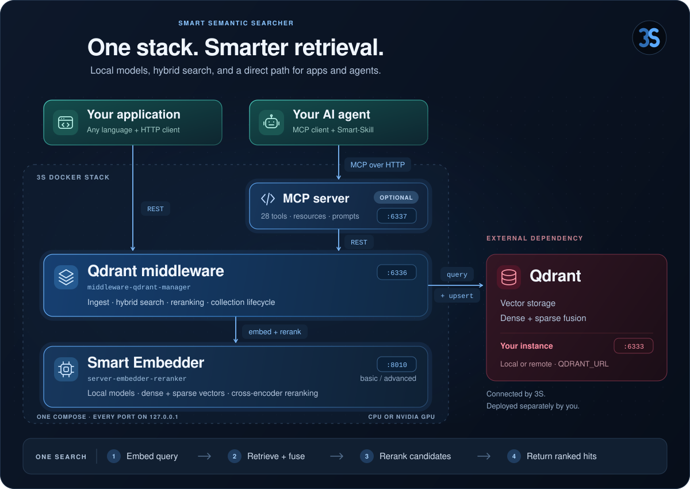

  

# Smart Semantic Searcher (3S)

**Smart Semantic Searcher (3S)** aims to be the shortest path to a hybrid-search
stack that runs on hardware you already own. Embedding, sparse lexical scoring
and reranking happen on your machine rather than behind a hosted inference API:
a laptop CPU is enough, a single consumer NVIDIA card makes it faster.

Concretely, it is an easy and efficient front door to **Qdrant hybrid search
plus reranking**: dense vectors catch meaning, sparse lexical matching catches
the exact term the dense model glossed over, Qdrant fuses the two into one
candidate list, and a cross-encoder — which reads query and passage together
instead of comparing two finished vectors — re-scores the top of that list.
That combination is what separates a search that finds the right paragraph from
one that finds a vaguely related page, and the point of this project is that
running it should cost you one command rather than a cloud contract. One
command *after* the setup, to be exact: a reachable Qdrant, an `.env` you
reviewed, and a first start that downloads the models.

Resource use is a design constraint, not a side effect. The models are small on
purpose — 0.6B-class embedders and rerankers, not 7B ones — only one of the
three services loads a model at all, and a pre-start autotuner calibrates batch
sizes and precision to the machine it actually finds instead of assuming a
datacenter.

**Where your data goes is your decision.** No inference call leaves your machine: the models run in your own
container. Everything else depends on how you wire it. Point `QDRANT_URL` at a
Qdrant on this host and the whole pipeline stays here; point it at a remote
cluster and your vectors and payloads live there. And an agent reaching the
stack through MCP is only as local as its own model — this project keeps its
own work on your machine, it cannot make a cloud-hosted agent private.

## So, what can I do with this software?

* **Search your own documents semantically.** One call ingests a batch of text
  chunks (`POST /points/ingest-chunks`, or `POST /points/ingest` for a JSON file
  you staged beforehand), one searches them (`POST /query/search`): the stack
  embeds, lets Qdrant fuse dense and lexical results server-side, reranks the
  top candidates with a cross-encoder, and returns ranked hits. Point IDs are
  derived from `source_id:chunk_id`, so re-sending a chunk overwrites it instead
  of duplicating it; when the revised document has *fewer* chunks than before,
  `replace_source=true` clears the leftovers, which it does not do by default.
* **Give a coding agent a private, searchable memory.** With the MCP server
  enabled, Claude Code or any other MCP client gets 28 typed tools over the same
  API — create a collection, ingest into it, search it, inspect it — with no
  search vendor anywhere in the path. What the agent's own model then does with
  the passages it read is between you and that agent.
* **Build a RAG backend without gluing three services together yourself.** You
  keep the decisions that are yours — how to chunk, what to store, when to
  re-ingest — and the stack owns everything between a chunk of text and a
  ranked hit.
* **Use it as nothing but a local embedding endpoint.** `EMBEDDER_ONLY=true`
  starts Smart Embedder alone: a `POST /embeddings/` and `POST /rerank` service
  on `127.0.0.1`, in place of a hosted embedding API, for anyone who already has
  their own retrieval stack.
* **Run the same stack on a laptop and on a workstation.** The `cpu` and `gpu`
  profiles serve the same API, the same models and the same collections. The GPU
  buys throughput, not capability — nothing is unavailable without one.
* **Drive it from a browser instead of curl.** With `EXPOSE_FRONTEND=true` the
  middleware serves a static console for creating collections, ingesting, and
  running searches by hand.
* **Change the model profile without changing your client.** `basic` and
  `advanced` swap the entire embedding and reranking set behind the same
  middleware API. The switch is a restart, and a client calling Smart Embedder
  directly should know that `advanced` serves no ColBERT vectors. Collections
  carry a fingerprint of the profile that created them, so an existing
  collection reports as incompatible instead of silently mixing two vector
  spaces — regenerate its vectors with the reindex job to bring it across.

## The stack

  

Three services, one root Compose file, one `.env`:

* **middleware-qdrant-manager** (`:6336`) is the only API you need to call. It
  checks the caller's bearer token — once you have configured tokens, since the
  shipped `.env.example` starts with local authentication switched off — embeds
  what has to be embedded, asks Qdrant for a fused candidate list, sends the top
  of it through the reranker, and returns ranked hits. It also owns collection
  creation, payload indexes and the durable vector-reindex job.
* **server-embedder-reranker** — Smart Embedder (`:8010`) — is the only
  component in the stack that loads a model. It serves dense, sparse and (on the
  `basic` profile) ColBERT vectors from one endpoint, plus a cross-encoder
  reranking endpoint. Model repositories are pinned to immutable Hugging Face
  commits, so a rebuild cannot silently move to different weights.
* **smart-qdrant-mcp** (`:6337`) is optional. It translates the same REST
  contract into MCP tools, resources and prompts for agents, and adds no
  capability the HTTP API does not already have.
* **Qdrant** stores the vectors and runs the fusion server-side. The stack does
  not start one — you point `QDRANT_URL` at yours.

Nothing here is exposed to the network by default: every published port binds to
`127.0.0.1`, the serving containers run unprivileged with read-only root
filesystems and bounded memory, CPU and PIDs, and the embedder can be taken off
the host network entirely so that the middleware is the only way in.
