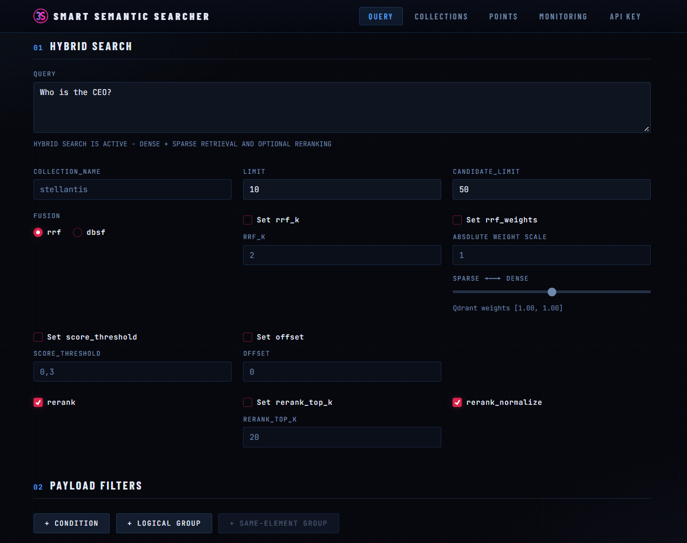
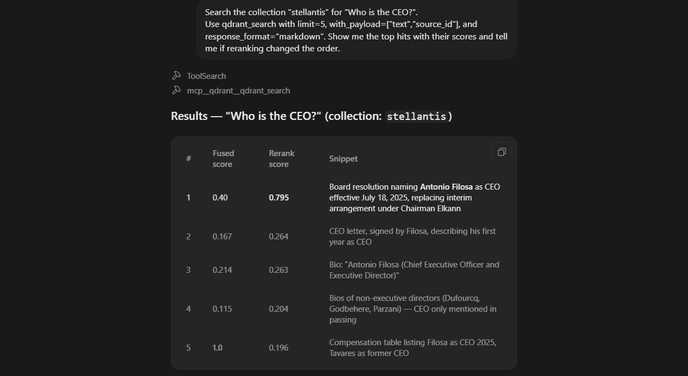

  

<h1 align="center">Smart Semantic Searcher (3S)</h1>

## 💡 What is it?

**Smart Semantic Searcher (3S)** aims to be the shortest path to a hybrid-search
stack that runs on hardware you already own. Embedding, sparse lexical scoring
and reranking happen on your machine rather than behind a hosted inference API:
a laptop CPU is enough, a single consumer NVIDIA card makes it faster.

Concretely, it is an easy and efficient front door to **Qdrant hybrid search
plus reranking**: dense vectors catch meaning, sparse lexical matching catches
the exact term the dense model glossed over, Qdrant fuses the two into one
candidate list, and a cross-encoder — which reads query and passage together
instead of comparing two finished vectors — re-scores the top of that list.
That combination is what separates a search that finds the right paragraph from
one that finds a vaguely related page — and running it should cost you one
command rather than a cloud contract.

**Running well on consumer-grade hardware is a design constraint, not a side
effect.** The models are small on purpose — 0.6B-class embedders and rerankers,
not 7B ones — and only one service in the stack loads a model at all. A
pre-start autotuner then probes the machine it actually finds and calibrates
batch sizes and precision to it, so the stack tunes itself to your hardware
instead of assuming a datacenter.

**Your data stays on your machine — that is the reason this project exists.**
No inference call goes out to a hosted AI API, the way AI features are usually
wired: the models run in your own containers, so nothing leaves your machine
or your VPN. Storage follows the same rule — Qdrant is an open-source vector
database you run yourself, on this host or on a remote cluster; either way
your vectors and payloads live on infrastructure you chose, and ownership
stays with you. The one boundary the stack cannot police is the agent on the
other side of MCP: this project keeps its own work on your machine, it cannot
make a cloud-hosted agent private.

## ⚙️ The stack

  

## 🛠️ What can I do with this software?

* **Search your own documents semantically.** You hand it text chunks — pages
  from your manuals, notes or reports — and it indexes them by meaning and by
  exact wording. Ask a question in plain language and you get back the
  passages that answer it, ranked best-first.
* **Build a RAG backend without gluing three services together yourself.** The
  retrieval pipeline is fully automated — text chunks in, ranked passages out
  — and every stage of it is a setting to flip, not code to write. You keep
  the decisions that are yours — how to chunk, what to store, when to
  re-ingest.
* **Give a coding agent a private, searchable memory — and let it drive.**
  With the MCP server enabled, Claude Code or any other MCP client operates
  the whole stack in natural language: 28 tools cover everything the API can
  do — create a collection, ingest a file of chunks, search it — with no
  search vendor in the path. The server also ships its own documentation, so
  the same agent can read the docs and explain back to you how it all works.
  What the agent's own model does with the passages it reads is between you
  and that agent.
* **Give that agent the playbook, not just the tools.** The bundled
  `smart-skill/` directory ships a drop-in Agent Skill: copy
  `smart-skill/smart-qdrant-mcp/` into your agent host's skills folder and the
  same agent stops improvising — it picks the right tool for each task,
  respects the confirmation gates around destructive operations, follows
  tested sequences for ingest and reindex, and knows how to recover when a
  call fails. Same agent, same tools — noticeably better with both.
* **Drive it from a browser instead of a terminal.** The built-in web console
  exposes the whole API as a point-and-click surface — run searches with every
  parameter on the table, create and manage collections, ingest points, watch
  live service telemetry. It is the quickest way to feel what the stack can do
  before you automate any of it.
* **Tailor the deployment to your needs.** The stack is composable — the MCP
  server, the web console, the API docs and the embedder's own network
  port are each a switch, so you run only the modules you use and nothing
  unused stays reachable. Even the models are swappable: two profiles — basic
  and advanced — replace the whole embedding and reranking set behind the same
  API, a restart rather than a client rewrite. Collections remember the
  profile that created them and refuse to mix two vector spaces silently; a
  reindex job carries them across.

## 🚀 How do I start?

Three things first: Docker with Compose 2.24.4 or newer and Python 3.10 or
newer on PATH; a Qdrant the stack can reach — a local container is enough,
or set `QDRANT_BUNDLED=true` and the stack starts one for you; and an `.env`
copied from `.env.example` and reviewed. Then one command:

    pwsh stack.ps1 up auto      # Windows (PowerShell)
    bash stack.sh up auto       # Linux / macOS

`auto` picks the hardware profile itself — GPU when one is usable, CPU
otherwise — and the first run downloads the models, so it is slower than
every run after. When it finishes, the middleware answers on
`http://127.0.0.1:6336` with the web console already on it.

`down` stops it again, `logs` follows it, `status` shows what is running —
[`cli.html`](guide/cli.html) covers the rest.

## 🖥️ How do I interact with it?

Open that address and every knob is on the page at once, so tuning a search is
editing a field and running it again — then you carry the settings that worked
into your own client.

  

The second surface is an agent, and it needs no screen at all: with the MCP
server enabled and the skill installed, the same operations happen in
conversation. You say what you want, it picks the tool and fills in the
parameters.

  

## 📚 Where do I learn more?

The `guide/` directory is a complete field guide you read in the browser —
six standalone pages that open straight from disk, no server or network
needed:

* [`getting-started.html`](guide/getting-started.html) — the first run end to
  end: the `.env`, a local or cloud Qdrant, `up auto`, connecting an agent,
  installing the skill, your first search.
* [`cli.html`](guide/cli.html) — the launcher commands: start, stop, logs,
  choosing CPU or GPU, applying settings.
* [`environment.html`](guide/environment.html) — the `.env` file explained:
  every parameter, searchable, with the values worth changing first.
* [`architecture.html`](guide/architecture.html) — how the pieces fit
  together: middleware, Smart Embedder, Qdrant, MCP and the agent skill.
* [`hybrid-search-rerank.html`](guide/hybrid-search-rerank.html) — what hybrid
  search and reranking actually do.
* [`embedding-models.html`](guide/embedding-models.html) — the models behind each
  profile: basic BGE and advanced Qwen + MILCO, their Hugging Face sources,
  and why ColBERT stays out of the search.

## 🤝 How can I contribute?

**The project is open source under [AGPL-3.0](LICENSE) and anyone who wants to
contribute is welcome.** One thing is worth saying up front, though: it was
built with very heavy use of AI coding agents, and it expects you to work the
same way.

So if you find a bug or want a feature, point the coding agent you prefer at
the repository before you write anything. `AGENTS.md`, the `guide/` pages and
the MCP server's own documentation resources exist precisely so that an agent
can read this codebase and work out what is really going on — which file,
which setting, which service. Then **open an issue** with what it found: how
to reproduce it, the trail it followed, what it believes the cause to be.

That is where the conversation starts, not where it ends. How a bug should be
fixed — or whether a feature belongs in the stack at all — gets decided
afterwards, in the issue.

On our side the project keeps moving, and two directions are already set. The
first is **following Qdrant as it grows**, so that what lands upstream becomes
an option here rather than a reason to rewrite. The second is **widening the
hardware it runs on**, so that a consumer NVIDIA card is the first accelerator
it supports well rather than the only one. Anyone who wants to push in either
direction is especially welcome.

---

  <strong>🔍 HAPPY SMART SEMANTIC SEARCH! 🔎</strong>

